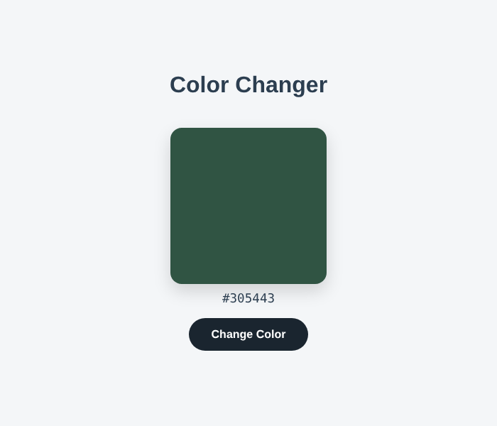

# Checkpoint DOM Project 2 : changeur de couleurs interactif

- `index.html` : un conteneur `.container` qui contient le titre « Color Changer », la boîte `#color-box` et le bouton `#change-color-btn`.
- `style.css` : contenu centré, boîte de taille fixe avec une couleur par défaut, bouton stylisé.
- `script.js` : le code s'exécute à l'événement `DOMContentLoaded`. La fonction `getRandomColor()` génère une couleur hexadécimale. Au clic sur le bouton, la boîte prend cette couleur.

Pour tester : ouvrir `index.html` dans le navigateur et cliquer sur **Change Color**.

